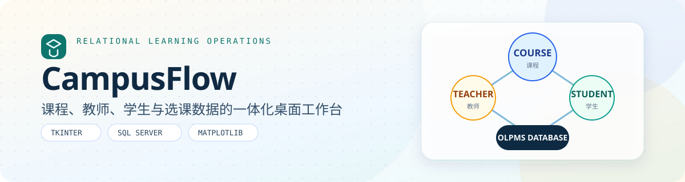
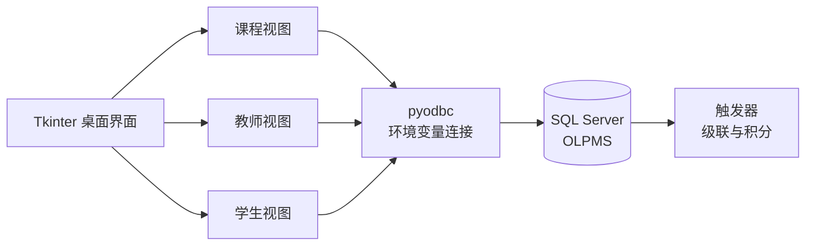

<p align="center">
  
</p>

# CampusFlow · 线上学习管理系统

**把课程、教师、学生与选课数据组织成一套可操作的桌面管理工作台。**

[](https://github.com/LB-Y06/study_database/actions/workflows/ci.yml)


[](LICENSE)

## 项目概览

CampusFlow 是一个基于 Python、Tkinter 和 SQL Server 的教学管理原型。它不仅提供课程、教师、学生三类实体的增删改查，还把选课、授课关系、成绩分布和课程完成积分联动到一个完整的数据模型中。

项目适合用于数据库课程设计、桌面应用实践和关系型数据建模展示。核心价值在于**界面操作与数据库约束同步设计**，而不是只做一层表格式的 CRUD。

## 核心能力

| 模块 | 能力 |
| --- | --- |
| 课程管理 | 课程查询、新增、修改、删除、教师关联与成绩分布图 |
| 教师管理 | 教师检索、详情查看、授课课程列表与关联维护 |
| 学生管理 | 学生检索、资料维护、已选课程与可选课程操作 |
| 选课流程 | 选择课程、退课、查看完成度与考试成绩 |
| 数据联动 | 删除级联、课程完成积分更新与聚合查询 |
| 初始化脚本 | 数据库、表结构、触发器与环境变量配置 |

## 数据架构



## 关系模型

```text
student ───< courseSelection >─── course ───< lectures >─── teacher
```

| 表 | 作用 |
| --- | --- |
| `course` | 课程名称、学时与类别 |
| `student` | 学生资料与累计积分 |
| `teacher` | 教师资料与联系方式 |
| `courseSelection` | 学生选课、完成度、等级与分数 |
| `lectures` | 教师授课关系与平均分 |

数据库脚本还包含三类行为：

- 删除学生时清理对应选课记录。
- 删除教师时维护授课关系和无主课程。
- 课程完成度首次达到 `100%` 时，将课程学时计入学生积分。

## 快速开始

### 环境要求

- Python 3.10+
- SQL Server 2019/2022
- Microsoft ODBC Driver 17 for SQL Server
- Windows 桌面环境（Tkinter 界面使用宋体显示教学图表）

### 1. 初始化数据库

在 SQL Server Management Studio 中打开并执行 [`sql.txt`](sql.txt)。脚本会创建 `OLPMS` 数据库、五张核心表及触发器。

### 2. 安装依赖

```powershell
python -m venv .venv
.\.venv\Scripts\Activate.ps1
pip install -r requirements.txt
```

### 3. 配置连接并启动

数据库凭据通过环境变量读取，不再写死在源码中：

```powershell
$env:OLPMS_SERVER = "localhost"
$env:OLPMS_DATABASE = "OLPMS"
$env:OLPMS_USERNAME = "sa"
$env:OLPMS_PASSWORD = "<your-password>"
$env:OLPMS_DRIVER = "ODBC Driver 17 for SQL Server"

Set-Location .\UI
python .\userInterface.py
```

如果 SQL Server 使用实例名，可将 `OLPMS_SERVER` 设置为 `localhost\SQLEXPRESS` 一类格式。

## 项目结构

```text
study_database/
├─ UI/
│  ├─ userInterface.py     # 主窗口与页面切换
│  ├─ course.py            # 课程列表与成绩分析
│  ├─ teacher.py           # 教师列表与授课详情
│  ├─ student.py           # 学生列表与选课详情
│  ├─ add_*.py             # 新增与修改表单
│  ├─ select_tree.py       # 已选课程
│  └─ not_select_tree.py   # 可选课程
├─ sql.txt                 # SQL Server 建库与初始化脚本
└─ requirements.txt        # Python 运行时依赖
```

## 验证

无需连接数据库即可检查 Python 语法：

```powershell
python -m py_compile (Get-ChildItem .\UI -Filter *.py).FullName
```

完整验证需要可用的 SQL Server 实例和有效 ODBC 数据源配置。

## 设计取舍

- **桌面优先**：使用 Tkinter 降低部署门槛，聚焦关系数据与交互流程。
- **数据库承担一致性**：外键式关联和触发器负责跨实体状态维护。
- **配置与代码分离**：主机、账号、密码和驱动均通过环境变量注入。
- **查询驱动视图**：课程统计、教师授课和学生选课直接复用 SQL 聚合结果。

## 已知边界

- 当前是单机管理端，没有账号登录和服务端多用户隔离。
- 界面默认使用 Windows 字体，其他系统需要调整 Matplotlib 字体。
- 成绩分布图依赖课程已有成绩；没有成绩时会显示空状态。

## License

代码采用 [MIT License](LICENSE)。
